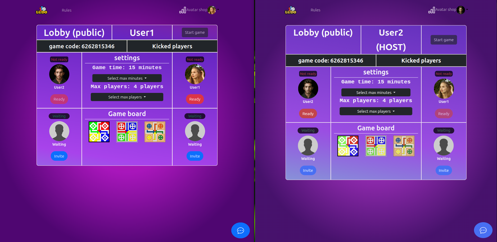

# ludo-lobby-vue

A lobby system built with Vue.js (Options API) and Spring Boot, built in 2024 by a college project team.

At college, our team of 6 students was tasked with building a multiplayer web-based board game. Within the team, I was mainly responsible for the lobby system's frontend and backend. The project taught me a lot about REST API integration, real-time communication with WebSockets, MySQL database design, and designing frontends with the SPA framework Vue.js.

## Screenshots

### Join Create

**Description:**

Webpage where the player can choose between creating a lobby or joining one.

---

### Create Lobby

**Description:**

Modal where the player can choose between creating a public or private lobby. Public lobbies can be joined through a 'Game Code', 'Quick Game' or through the lobby list. A private lobby can only be joined with the 'Game Code'.

---

### Join Lobby

**Description:**

Modal where the player can choose between joining with 'Game Code', 'Quick Game' or go to the lobby list.

---

### Lobby List

**Description:**

A list of all the public lobbies currently available.

---

### Lobby

**Description:**

A lobby with different settings that can be adjusted by the host, such as 'Game time', 'Max players' and the 'Game board'. The host can also kick players, who are then placed on a kicked list and can no longer rejoin.

---

### Lobby Chat

**Description:**

A live chat system with the players currently in the lobby.

---

### Avatar Shop

**Description:**

Purchase 'Avatars' for your profile with the 'LudoCoins' you have earned when playing the game.

---

## Tech Stack

- Frontend: Vue.js (Options API)
- Backend: Spring Boot

## License

This project is licensed under the terms of the LICENSE file in this repository.
